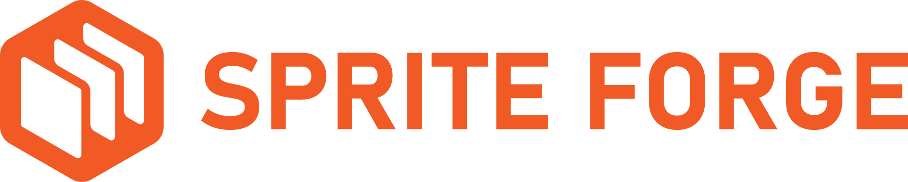

<p align="center">
  
</p>

<h1 align="center">SpriteForge Studio</h1>

<p align="center">
  <strong>Native Desktop Workstation for AI Video to 2D Game Sprite Sheets & Atlases</strong><br>
  Built with <b>Tauri 2.0 + Rust</b>, React 18, and TypeScript. Zero Python or heavy ML runtimes required.
</p>

<p align="center">
  <a href="https://www.patreon.com/primeforgestudio"></a>
  
  
  
</p>

---

## ✨ Features

### 🎬 AI Video to Sprite Sheet Pipeline
* **Multi-Format Ingestion**: MP4, WebM, MOV, AVI, and PNG image sequences via drag-and-drop.
* **Non-Destructive Trimming & Scrubbing**:
  * In/Out crop points for frame ranges.
  * Instant keyframe distribution across animation cycles (`12`, `15`, `24`, `30`, `60` FPS).
* **Advanced Chroma Keying & Color Suppression**:
  * Real-time eyedropper for primary and secondary key colors.
  * Screen Gain, Balance, Clip Black, Clip White, Soften controls.
  * Despill suppression with Warm-Safe skin tone protection.
  * **Topological Border Clean**: 4-way BFS flood-fill eliminating compression halo artifacts and edge green dust without eroding interior cavities.
  * **Dual-Stream / Alpha Matte Pass**: direct luminance blending for ComfyUI / RMBG / BiRefNet alpha masks.

### 🕹️ Atlas Studio & Live Playback Inspector
* **Full-Featured Sheet Viewer**:
  * Grid lines overlay and numbered frame badges (`#0, #1, #2... #N-1`).
  * Real-time dancing bounding box tracking the currently playing frame across the sprite sheet.
  * Interactive click-to-inspect cell jumping.
* **Real-Time Character Player**:
  * Responsive character preview with pixelated crispness.
  * `Loop`, `Ping-Pong`, and `Once` playback modes.
  * Onion skinning (cyan ghost for previous frame, orange ghost for next frame).
  * Variable speed multiplier (`0.25x` to `2.0x`) and custom FPS.
* **Smart Frame Filters**:
  * `Even` & `Odd` 1-click downsamplers (halves frame rate from 24/30 FPS to 12/15 FPS without stutter).
  * `All`, `None`, and `Invert` selection modes.

### 🛠️ Game Engine Exporters & Optimization
* **Godot 4 Integration**:
  * Automatic `.tres` `SpriteFrames` resource generation with custom pivot points and animation loop settings.
  * 2D Silhouette Mesh triangulation for GPU overdraw reduction.
* **2D PBR Maps**:
  * Sobel-based tangent-space 2D normal maps (`_normal.png`).
  * Dynamic roughness (`_rough.png`) and emission (`_emission.png`) maps.
* **PNG-8 NeuQuant Compression**:
  * 60%–80% file size reduction with adaptive palette quantization.
* **Animation Polishers**:
  * Seamless Loop Synthesizer (crossfade loop blending).
  * Retro Pixel-Art Converter (PICO-8, Game Boy, DB32, EDG32 palettes with Bayer dithering and 1px outline).
  * Temporal De-Flicker & Ground-Snap baseline locking.
  * Root motion drift stabilizer (In-Place centering).

### ↩️ History Management
* Full 50-step undo/redo stack (`Ctrl+Z`, `Ctrl+Shift+Z` / `Ctrl+Y`) covering all keying, cropping, and atlas layout changes.

---

## 💖 Support the Project

SpriteForge Studio is **100% Free and Open-Source**. If it saves you time and powers your game development workflow, consider supporting ongoing development:

* **Patreon**: [patreon.com/primeforgestudio](https://www.patreon.com/primeforgestudio) *(Credit Cards / PayPal)*
* **Crypto Tip (USDT TRC-20)**:
  ```text
  TP4teMUZ56aLrNT1DPzm8N42y4fjEY4WCi
  ```
  *(Network: TRON / TRC-20 — Bybit, Binance, Trust Wallet, etc.)*
* **Star on GitHub**: Give us a ⭐ on GitHub to help more developers discover the project!

---

## 🚀 Quick Start

### Windows Desktop (Recommended)
Simply launch `run.bat` or the standalone executable:
```cmd
src-tauri\target\release\app.exe
```

### Development
1. **Install dependencies**:
   ```bash
   npm install
   ```
2. **Start Tauri dev workstation**:
   ```bash
   npm run tauri:dev
   ```
3. **Build standalone release binary**:
   ```bash
   npm run build
   npx tauri build --no-bundle
   ```

---

## 🏗️ Architecture

* **Frontend**: React 18, TypeScript, Lucide Icons, Vite 5, Canvas 2D / WebGL.
* **Core Engine**: Tauri 2.0, Rust (`src-tauri/src/modules/`):
  * `chromakey.rs`: Parallel chroma keying & BFS topological cleaning.
  * `pbr.rs`: Tangent-space Sobel normal maps and PBR textures.
  * `mesh.rs`: 2D silhouette mesh triangulation.
  * `atlas.rs`: Bounding box detection and bin-packing.
  * `godot.rs`: Godot 4 `.tres` resource generation.

---

## 📄 License
MIT License.
